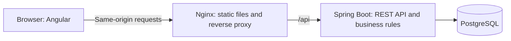

# Self-Care Planner

A full-stack web application for planning and tracking hair care, skin care, makeup, and nail care. It brings recurring routines, individual appointments, reminders, and completed-care history into one planner.

[Open the application](https://agenda-autocuidado.mayezer.com) · [Project documentation](docs/PROJECT.md) · [Development guide](docs/DEVELOPMENT.md) · [Security and configuration](docs/SECURITY.md)

The interface is in Brazilian Portuguese. This repository's public documentation is in English.

## The problem

Keeping several self-care routines organized means remembering dates, adjusting plans, and tracking what was actually done. Self-Care Planner gives each account a shared agenda across four care categories, with a public hair-schedule preview before registration.

The project focuses on personal organization and educational cosmetic-care guidance. Its suggestions do not diagnose conditions or promise treatment results.

## Features and current scope

The initial pilot is published. The release scope recorded on **November 26, 2026** includes registration with email confirmation, sign-in, the planner, history, private profiles, guides, and in-app reminders.

- Preview a hair schedule without an account; sign in to save it while keeping your edits.
- Create recurring hair and skin routines and individual skin, makeup, and nail-care appointments.
- Complete, skip, reschedule, and undo care actions; close a routine while preserving its history.
- Browse the weekly agenda, upcoming care, overdue items, and history.
- Save an optional hair profile and request an editable schedule with explanations for each suggested session.
- Organize a makeup inventory and recurring brush/sponge cleaning reminders.
- Manage a private account name and photo, change your password, and optionally enable authenticator-based two-factor authentication. The administrative owner must keep it enabled.
- Use a responsive interface with keyboard navigation, reduced-motion support, and three themes.

Products, browser Web Push, billing, the private hair diary, and the forum have code in the repository but remain disabled in the recorded public release and in the default local configuration. Their presence in the source does not mean they are available to users. See the [module status and requirements](docs/PROJECT.md).

## Architecture

The application uses a client-server architecture with a layered Spring Boot backend organized by domain. The backend is one application, with shared transactions and a PostgreSQL database.



The published topology uses a Cloudflare Worker and Durable Object to manage a container running Nginx and Java, backed by PostgreSQL on Neon. Local development uses Docker Compose. Ownership checks, civil dates, state transitions, and schedule generation stay on the server.

| Layer | Technologies |
|---|---|
| Frontend | Angular, TypeScript, RxJS, CSS |
| Backend | Java 25, Spring Boot, Spring Security, Gradle |
| Persistence | PostgreSQL, Spring Data JPA, Hibernate, Flyway |
| Local environment | Docker Compose, Nginx, Mailpit |
| Delivery | GitHub Actions, Cloudflare Workers/Containers, Neon |
| Verification | JUnit, PostgreSQL integration tests, Vitest, deployment tests, Gitleaks |

Exact versions live in [.java-version](.java-version), [.nvmrc](.nvmrc), [backend/build.gradle](backend/build.gradle), [frontend/package.json](frontend/package.json), and the Dockerfiles. See the [architecture and business rules](docs/PROJECT.md) for module boundaries and consistency decisions.

## Run locally

You need Docker with Compose. Create `.env` from [.env.example](.env.example) if it does not already exist. Set three distinct **local test passwords** in `LOCAL_DB_PASSWORD`, `LOCAL_DB_MIGRATION_PASSWORD`, and `LOCAL_DB_RUNTIME_PASSWORD`. Set `LOCAL_AUTH_MFA_KEY` to a dedicated random 32-byte key encoded as 64 hexadecimal characters, and preserve it while reusing the database volume. Keep these values in the private local file.

From the repository root:

```sh
docker compose -p autocuidado-dev --profile mail up --build --wait
```

Open the [local application](http://127.0.0.1:4222/) and [Mailpit](http://127.0.0.1:8025/). Mailpit captures test registration and recovery emails. Use the same Compose project name for later commands, and select different ports in `.env` if another instance is already running.

The [development guide](docs/DEVELOPMENT.md) covers account creation, MFA, running Java and Angular directly, API examples, persistence checks, optional modules, and troubleshooting.

## Build and test

Run these commands from the indicated directories:

```sh
# backend/
./gradlew clean build

# frontend/
npm ci
npm test
npm run build
```

PostgreSQL integration tests use `./gradlew postgresqlTest` with a fresh, dedicated test database and the connection variables described in the [test instructions](docs/DEVELOPMENT.md#tests).

[GitHub Actions](.github/workflows/ci.yml) builds both applications, runs unit/API and PostgreSQL tests, audits npm dependencies, scans Git history for secrets, and tests deployment and rollback decisions. Deployment workflows are manual; updating documentation does not deploy the application.

## Documentation

| Document | Contents |
|---|---|
| [Project](docs/PROJECT.md) | Functional and non-functional requirements, architecture, business rules, and module status |
| [Development](docs/DEVELOPMENT.md) | Setup, configuration names, test accounts, API examples, and verification commands |
| [Security](docs/SECURITY.md) | Public/private file boundaries, secret handling, publication checks, and documentation maintenance |
| [Lessons learned](docs/LESSONS_LEARNED.md) | Selected defects, fixes, measured results, and their limits |
| [Deployment](deploy/README.md) | Cloudflare and Compose deployment, migrations, rollback, and recovery |

Keep these documents aligned with changes to behavior, configuration, migrations, or release scope. Only the named public documents are allowed through `.gitignore`; internal acceptance records and operational evidence stay local. Follow the [documentation update checklist](docs/SECURITY.md#keeping-documentation-current) before publishing changes.
